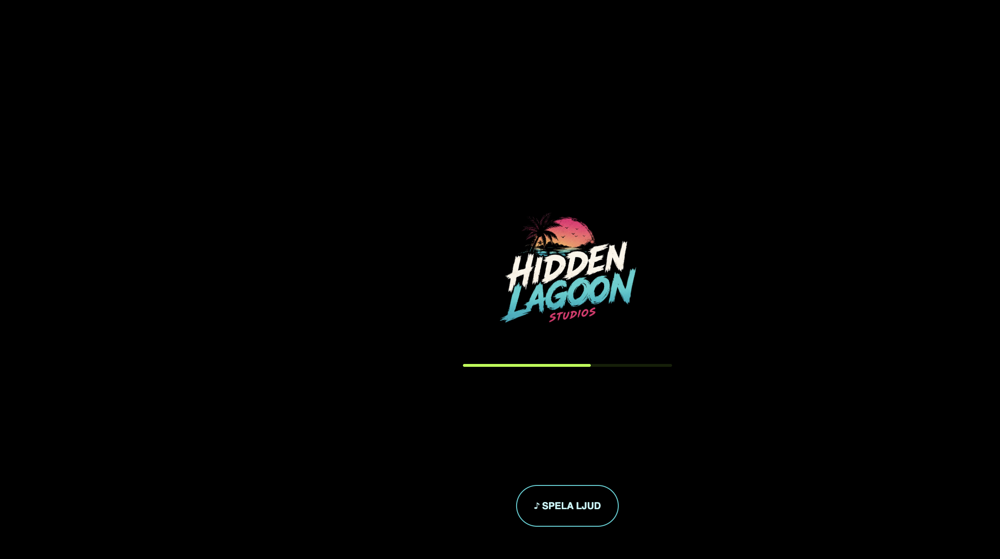

# Hidden Lagoon Studios 🌴

Jag är skaparen bakom **Snuggiez** och **Hidden Lagoon**. Jag bygger en egen spelvärld med katter, kustmiljöer och udda invånare — med mycket personlighet i både figurer och detaljer.

## 🎮 Hidden Lagoon

Ett spelprojekt under utveckling där miljöer, illustrationer, ljud och interaktion möts i webbläsaren.

Mina publika repositories innehåller olika versioner och experiment från arbetet.

[Utforska projektet →](https://github.com/snuggiez/hiddenlagoon)

## Fler projekt från studion

### ⌨️ CrispKeys

Min dator har för tillfället ett italienskt tangentbord. Jag ville både få ett bättre ljud när jag skriver och kunna skriva rätt symboler — det blev startpunkten för CrispKeys.

En macOS-app med valbara ljudprofiler, volymkontroll och separat ljudutgång för tangentljuden.

**Lokal app under utveckling — ingen publik nedladdning ännu.**

### 🐠 FISHDEX
En illustrerad akvarieapp med artkort, samling och ett eget digitalt akvarium.

**Prototyp under utveckling.** Artuppgifterna är preliminära och inte faktagranskade.

[Prova FISHDEX →](https://fishdex-lagoon-test.netlify.app/)

### 🚲 Cykeltåget
En webbapp för att utforska tågresor med cykeln som resesällskap.

**Under utveckling.**

[Utforska Cykeltåget →](https://cykeltaget.netlify.app/)

### 🐸 SYV-ARNA
En prototyp där elever kan utforska intressen, yrken och gymnasievägar — själva eller tillsammans med en studie- och yrkesvägledare.

**Testdemo under utveckling.**

[Prova SYV-ARNA →](https://syv-arna-test.netlify.app/)

### 💙 Lilla kompisen
En digital figur med uttrycksfulla ögon, små reaktioner och lekfulla interaktioner.

**Lokal prototyp — ingen publik demo ännu.**

## 🛠️ Bakom kulisserna

Jag driver idéerna och den kreativa riktningen. AI är en del av arbetsprocessen och hjälper till med kod, felsökning och utveckling av prototyper.

Just nu ligger fokus på att få spelets olika delar att hänga ihop och ge Hidden Lagoon en tydligare helhet.
